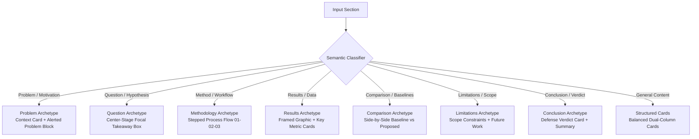
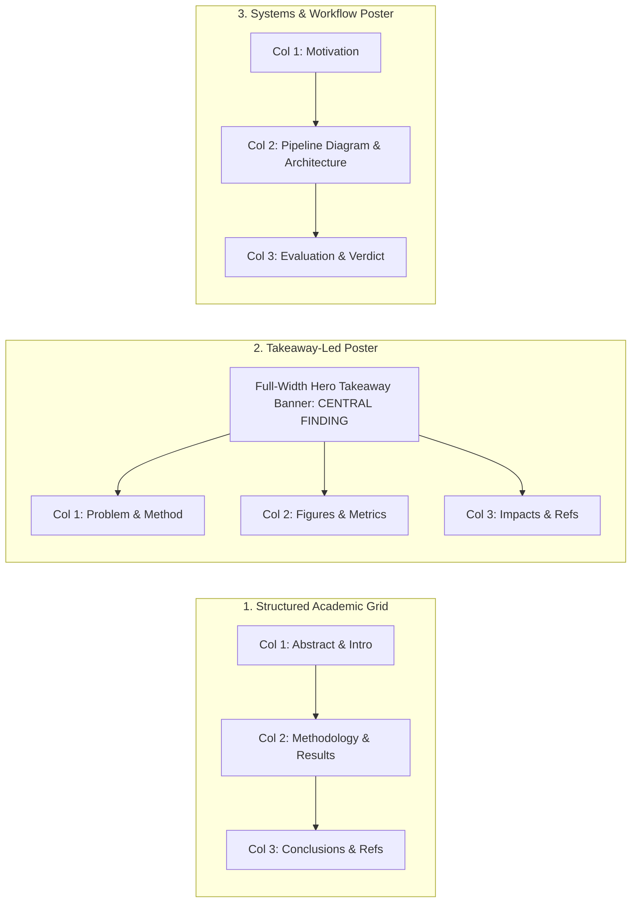

# SARAL AI — Research Presentation and Poster Design System

## 1. Design Vision & Philosophy

SARAL AI bridges the gap between dense academic research and accessible, impactful communication. The template redesign elevates generated research artifacts to the standard expected at premier academic conferences, lab defenses, and cross-disciplinary symposia.

### Core Principles

1. **Research-First Hierarchy**: Every slide and poster section immediately establishes what problem was studied, how it was evaluated, what the primary evidence shows, and why it matters.
2. **Editorial Composition**: Slides and poster blocks use intentional card containers, contrasting headers, and deliberate spatial grouping rather than unstyled, monotonic bullet lists.
3. **Evidence-Led Visual Storytelling**: Figures, diagrams, equations, and quantitative findings receive prominent visual framing rather than decorative illustrations.
4. **Controlled Visual Rhythm**: Meaningful variation in layouts across a slide deck (context cards, focal questions, stepped workflows, comparison columns, framed figure blocks) maintains audience engagement while preserving visual coherence.
5. **Whitespace with Purpose**: Layouts are dynamically balanced so that slides and poster columns never exhibit accidental emptiness or cramped overflow.
6. **Scientific & Mathematical Fidelity**: Formulas, notation ($O(n)$, $\alpha$, $\sum$), and exact figures from source papers are preserved without corruption or escaping errors.
7. **Absolute Research Integrity**: No fabricated metrics, unverified affiliations, false demo links, or promotional artifacts are ever introduced.

---

## 2. Design Tokens

### 2.1 Color Palettes

The design system provides five distinct academic color palettes suited to diverse scientific disciplines:

| Theme Identifier | Primary Header | Accent / Highlight | Surface Card | Field / Discipline |
|---|---|---|---|---|
| `saral` / `classic_navy` | Deep Navy (`#0F2741`) | Warm Amber (`#D97706`) | Off-White (`#F8FAFC`) | General Academic, Multidisciplinary (Default) |
| `metropolis` / `clean_slate` | Slate Charcoal (`#1E293B`) | Electric Indigo (`#4F46E5`) | Light Mist (`#FAFAFA`) | Computer Science, AI, Modern Engineering |
| `berkeley` | Cobalt Blue (`#1E3A8A`) | Cyan Accent (`#0284C7`) | Sky Tint (`#F8FAFC`) | Applied Sciences, Mathematics, Statistics |
| `cambridgeus` / `academic_burgundy` | Harvard Crimson (`#881337`) | Rose Accent (`#BE123C`) | Rose Tint (`#FFF1F2`) | Humanities, Law, Social Sciences |
| `paloalto` / `vibrant_indigo` | Deep Navy (`#0A2540`) | Vivid Azure (`#0070F3`) | Cool Grey (`#F4F8FA`) | Biotechnology, Medicine, Clinical Trials |
| `teal_emerald` / `modern_teal` | Deep Forest (`#064E3B`) | Emerald (`#059669`) | Mint Tint (`#ECFDF5`) | Environmental Science, Ecology, Energy |

### 2.2 Semantic Color Mapping

- **`saralprimary`**: Frame titles, poster banners, major structural accents.
- **`saralsecondary`**: Sub-headers, step number badges, secondary dividers.
- **`saralaccent`**: Quotation marks, core metric callouts, footline accents.
- **`saralsurface`**: Standard card body background (high readability, low glare).
- **`saralalertprimary` & `saralalertsurface`**: Alert blocks for central research questions, primary findings, and key takeaways.
- **`saralborder`**: Subtle card borders (0.8pt) defining spatial boundaries without clutter.

### 2.3 Typography Scale

- **Presentation (16:9 Widescreen, 10pt base)**:
  - Title Slide Header: `\LARGE\bfseries`
  - Frame Titles: `\large\bfseries`
  - Card Titles: `\footnotesize\bfseries`
  - Body Text: `\small` / `\normalsize`
  - Footline & Badges: `\scriptsize`
- **Poster (120cm × 72cm Landscape, 1.2 scale)**:
  - Poster Title: `\VeryHuge\bfseries`
  - Authors & Affiliations: `\Large`
  - Block Titles: `\large\bfseries`
  - Body Text: `\normalsize`
  - References: `\footnotesize`

---

## 3. Presentation Archetypes

Rather than forcing every slide into a generic left-column itemize list, the engine classifies sections into content-driven archetypes:

### Archetype Details

1. **Title Slide**:
   - Deep navy full-bleed backdrop with dual accent geometry lines.
   - Prominent paper title, author list, date, and SARAL research indicator.
2. **Problem & Motivation**:
   - Context & Background card on top.
   - Core Challenge / Research Problem highlighted in a high-contrast alert container.
3. **Research Question & Hypothesis**:
   - Large centered focal quotation card isolating the primary thesis.
   - Supporting objectives in organized cards below.
4. **Methodology & Architecture**:
   - Stepped sequential workflow cards (`Phase 01`, `Phase 02`, `Phase 03`).
   - When an architecture diagram is available, it receives a framed figure box on the right.
5. **Results & Empirical Evidence**:
   - When a figure is present: 52% empirical insights cards on left, 44% framed graphic on right.
   - When no figure is present: Primary empirical finding card on top, detailed metrics in split cards below.
6. **Comparative Analysis**:
   - Two-column balanced contrast: Baseline / Prior Approaches (`saralcard`) on left vs Proposed / Present Work (`saralaccentcard`) on right.
7. **Limitations & Future Work**:
   - Honest academic split: Scope & Limitations warning card on left, Future Directions & Open Questions accent card on right.
8. **Conclusion & Defense Verdict**:
   - Central Verdict & Contribution banner card on top, followed by structured summary points.

---

## 4. Poster Compositions

The poster generator supports three production layouts on a standard 120cm × 72cm conference canvas:

### Dynamic Column Balancing

A major defect in legacy templates was leaving Column 2 80% empty when no figures were uploaded. The redesign implements dynamic content distribution:
- **0 Images**: Column 1 contains Abstract & Intro; Column 2 contains Methodology & Key Results (Alerted); Column 3 contains Conclusion & References. All columns are visually balanced.
- **1 Image**: Column 1 contains Foundations & Methods; Column 2 features Empirical Results + Primary Figure (18cm height); Column 3 contains Conclusions & References.
- **2+ Images**: Figures are distributed cleanly across Column 2 and Column 3 with individual captions.

---

## 5. Multilingual and Indic Script Support

SARAL is committed to democratising research across Indian languages. The design system retains full compatibility with the 22 scheduled Indian languages:
- **Font Engine**: Automatically pairs Indic language codes (`hi-IN`, `ta-IN`, `bn-IN`, etc.) with `Noto Serif Devanagari`, `Noto Serif Tamil`, `Noto Serif Bengali`, and corresponding Noto script fonts.
- **Unicode Run Wrapping**: Wraps Indic-script Unicode sequences inside `{\<lang>font ...}` macros without breaking English punctuation or mathematical expressions.
- **Integrated in Both Presentations and Posters**: While legacy posters lacked font declarations entirely, the redesigned poster engine natively includes `fontspec`, language declarations, and Unicode run wrappers across all layout blocks.

---

## 6. Frontend Customization Experience

To match the presentation workflow where users select themes and options before generation, posters now include a dedicated modal:

- **`PosterConfigModal`**:
  - **Theme Selection**: 5 color palettes with interactive visual swatches and descriptive labels (`Classic Navy`, `Modern Teal`, `Academic Burgundy`, `Clean Slate`, `Vibrant Indigo`).
  - **Layout Selection**: 3 layout options with architectural descriptions (`Structured Grid`, `Takeaway-Led`, `Workflow-Led`).
  - **Preset Defaults**: Defaults to `Classic Navy` and `Structured Grid` for standard academic conferences.
  - **State Integration**: Connects via `poster-slice.ts` and `artifact-store.ts`, forwarding options seamlessly through API calls to Gateway and Redis worker queues.

---

## 7. LaTeX Hardening & Geometry Integrity

1. **Booktabs Inclusion**: Ensures `\usepackage{booktabs}` is loaded in presentation preambles for publication-standard table rules (`\toprule`, `\midrule`, `\bottomrule`).
2. **Fragile Frames**: Automatic regex detection for verbatim and code snippets (`\verb`, `\begin{verbatim}`, `\begin{lstlisting}`) adds `[fragile]` to `\begin{frame}`, preventing compiler crashes.
3. **Footline Title Slicing**: Truncates plain text strings prior to LaTeX escaping and font macro wrapping, preventing split command tokens or broken braces.
4. **Math Multiline Splitting**: Disables paragraph division (`\par`) inside display math environments (`\[...\]`, `align`), eliminating `Paragraph ended before \[ was complete` fatal errors.
